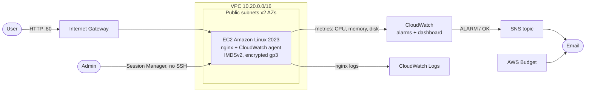

# Monitored web server on AWS with Terraform

A small, production-style AWS stack built with Terraform: a Linux web server in its own VPC, managed without SSH, with CloudWatch metrics, alarms, email alerts, a dashboard, a cost budget and a runbook. I built it to practise the way I'd run a real service: provision as code, monitor, alert, respond, and write up what happened.


## Architecture



## What it does

| Area | Detail |
|---|---|
| Network | VPC, two public subnets across availability zones, internet gateway, route table |
| Compute | EC2 (Amazon Linux 2023, `t3.micro`), bootstrapped by `user_data` to run nginx |
| Access | No SSH and no key pair: port 22 is closed, admin access is through **SSM Session Manager** |
| Security | Least-privilege IAM instance role, IMDSv2 enforced, encrypted root volume, HTTP source CIDRs configurable |
| Monitoring | CloudWatch agent sends memory, disk and nginx logs; alarms for CPU, memory, disk and status checks |
| Alerting | Alarms notify an SNS topic that emails you on both ALARM and OK |
| Visibility | CloudWatch dashboard with CPU, memory/disk and alarm status |
| Cost control | AWS Budget emails at 80% of a monthly limit (default US$5) |
| Operations | [Runbook](docs/runbook.md) per alarm, [incident drill](scripts/incident-drill.sh) and [post-incident review template](docs/postmortem-template.md) |
| CI | GitHub Actions runs `terraform fmt`, `validate` and `tflint` on every push |

## Run it

**You need:** an AWS account (use an IAM user or IAM Identity Center, not the root user), AWS CLI v2 configured, Terraform 1.6+, and the [Session Manager plugin](https://docs.aws.amazon.com/systems-manager/latest/userguide/session-manager-working-with-install-plugin.html) for shell access.

```bash
git clone https://github.com/sajanib/aws-terraform-monitored-web.git
cd aws-terraform-monitored-web
cp terraform.tfvars.example terraform.tfvars   # set alert_email
terraform init
terraform plan
terraform apply
```

1. Confirm the **SNS subscription email** AWS sends you, or you won't get alerts.
2. Open `terraform output web_url` in a browser.
3. Open `terraform output dashboard_url` to see the metrics (memory and disk appear after a few minutes).
4. Get a shell: run the command from `terraform output ssm_session_command`.

## Incident drill

```bash
./scripts/incident-drill.sh
```

This pushes CPU to 100% for 15 minutes using SSM Run Command. The `cpu-high` alarm should fire and email you, then return to OK when the load stops. Work through the [runbook](docs/runbook.md#cpu-high) as if it were real, and write a short review from the [template](docs/postmortem-template.md).

## Cost and teardown

This is designed to cost cents, not dollars: one small instance, no NAT gateway, no load balancer, 7-day log retention. Check AWS's current Free Tier terms for your account. Running it continuously still costs a few dollars a month (the instance and its public IPv4 address), so **destroy it when you are done**:

```bash
terraform destroy
```

## What I would add next

- Remote state in S3 with locking
- An Application Load Balancer and Auto Scaling group across both subnets
- Configuration management with Ansible instead of `user_data`
- GitHub Actions deploying with OIDC (no long-lived AWS keys)

## About

Built by [Sajani Banneka](https://www.linkedin.com/in/sajani-banneka), systems engineer (Linux, AWS, production support). See also my Master's research: [serverless-cold-start-openwhisk](https://github.com/sajanib/serverless-cold-start-openwhisk).
